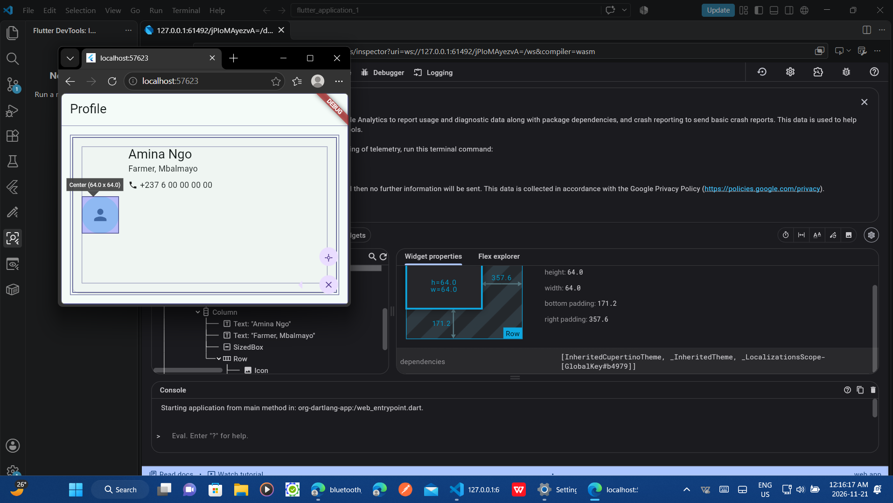

 Lab 2: Dart and my first screens

## What I learned
i learned many thing from the constant mistakes i kept making which can be seen below

- Named parameters go inside `{ }`, and `required` forces the caller to give a value.
- Null safety: `String?` can be null. I use `??` for a default value and avoid `!`.
- `where` filters a list, `map` transforms it, `fold` gives one total.
- `await` pauses the function that waits, not the whole app.
- Everything is a widget, and widgets form a tree.
- A StatelessWidget returns its screen in the `build` method.
- `const` lets Flutter reuse a widget instead of rebuilding it.
- `Row` and `Column` place children. `Expanded` gives a child the remaining space.
- `ListView.builder` builds a list from data.
- Rule: constraints go down, sizes go up, parent sets position.

**Overflow**
A long `Text` in a `Row` caused yellow and black stripes, because a Row does not limit the width of its children. I fixed it by adding the text in `Expanded`.

 Where i had issues

- `dart run` failed because I forgot the file name. The fix was `dart run lab2_dart.dart`.
- My first commit had 131 files. I made one `Initial Flutter project` commit, then small commits.
- The overflow did not appear at first"
   
   
    
    